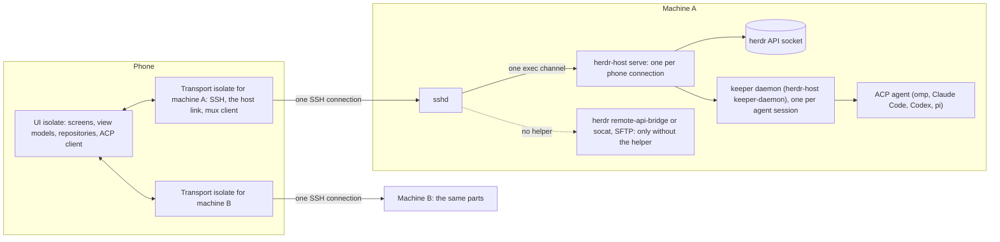

# Architecture

How herdr mobile works, what it runs on your machines, and what it keeps on the
phone. It is written for someone deciding whether to give the app SSH access to
their machines. Every claim names the file it comes from. Paths are relative to
the repository root.

herdr mobile is a Flutter Android app. It supervises coding agents that run
under [herdr](https://github.com/herdrdev/herdr) on your own machines. It has
two kinds of session:

- **Terminal sessions**: herdr panes. The app reads what a pane shows and sends
  keys to it through herdr's API.
- **Agent sessions**: agents that speak the
  [Agent Client Protocol](https://agentclientprotocol.com) (ACP). The app is
  the ACP client, and a small keeper process on the host owns the agent
  (`docs/AGENT_SESSIONS.md`).

## 1. What runs where



On the phone:

- The UI isolate runs the widgets, the view models and the repositories. It
  also runs the ACP client, which parses the agent's JSON-RPC lines
  (`app/lib/data/acp/json_rpc.dart`).
- One transport isolate per machine runs the SSH connection. It handles the
  encryption, the host link's frames and their decompression, JSON decoding of
  herdr's answers, and the file transfers
  (`app/lib/data/services/isolate_transport.dart`,
  `app/lib/data/services/transport_factory.dart`, `app/lib/data/host/`).

On each machine:

- **sshd.** The app needs nothing else listening. It opens no ports and installs
  no service.
- **herdr and its API socket.** The app talks to herdr only through that socket.
- **`herdr-host`, the agent helper.** One self-contained Rust program
  (`rust/crates/host`), downloaded from this app version's release and kept at
  `~/.herdr-mobile/bin/herdr-host-<app version>` (section 3). The app runs
  `herdr-host serve` on **one** exec channel per machine, and everything below
  is a stream on that channel: herdr's requests and events, agent sessions, log
  following, file reading and watching, inbox uploads, port listing and Made
  verification. `serve` lives exactly as long as that channel, listens on
  nothing and keeps no state. The wire, the services and what each may do are
  in `docs/HOST_PROTOCOL.md`; this file does not repeat them.
- **The keeper.** Only if you use agent sessions. It is the same binary run as
  `herdr-host keeper-daemon`, one process per agent session, started by `serve`
  on request. Each keeper owns one agent process, so the agent keeps running
  when the phone's connection drops (`rust/crates/keeper`,
  `docs/AGENT_SESSIONS.md`). The desk client `herdr-tui` is built on the same
  keeper library (`docs/TUI.md`).
- **Nothing in python, nothing to compile.** No interpreter is needed on the
  machine and none ships in the app or its tests.

A machine without the helper (no build for its CPU, offline, GitHub blocked)
still works, with less: section 2 says what.

There is no relay server and no account. The app does not talk to any server
of its own (section 5).

## 2. Connection model

### One connection per machine

Each saved machine gets its own `MachineConnection`
(`app/lib/data/repositories/machine_connection.dart`). Each connection gets
its own transport, created through `createSshTransportLater`
(`app/lib/app.dart:42-67`, `app/lib/data/services/transport_factory.dart`).
The transport runs `SshTransport` inside a worker isolate
(`app/lib/data/services/ssh_transport.dart`). That gives each machine one SSH
connection (one `SSHClient`). Its one exec channel is the helper link:

`herdr-host serve`, started on first use by `SshTransport` (`_startHost`) and
shared by every feature of the machine (`app/lib/data/host/host_link.dart`). The
features are streams on it, many at once, with flow control per stream so a
download cannot starve a permission answer (`docs/HOST_PROTOCOL.md`):

| Stream | Lifetime | Source |
| --- | --- | --- |
| The mux (`herdr.mux`): every herdr request | Persistent | `ssh_transport.dart` `_startMux`, `mux_client.dart`, `host_channels.dart` |
| Events (`herdr.events`): one subscription | Persistent while connected | `ssh_transport.dart` `events`, `machine_connection.dart` `_watch` |
| Keeper calls (`keeper.list`, `start`, `history`, `kill`) and attaches (`keeper.attach`) | A call is one request; at most 4 attached sessions per machine | `ssh_agent_host.dart`, `docs/ENGINEERING.md` "Permission safety" |
| Session log follow (observed omp, Claude Code and Codex sessions: `keeper.follow`, `keeper.blob`) | While a screen shows it | `ssh_log_source.dart` |
| Files (`fs.stat`, `list`, `read`, `watch`) and uploads (`transfer.*`) | A call or a stream per use; a watch while a viewer is open | `host_files.dart`, `host_transfer.dart` |
| Ports (`ports.watch`) and Made checks (`made.verify`) | While the Ports sheet or the Made sheet is open; `verify` once when Made opens | `host_ports.dart`, `made_verification.dart` |
| Looking for a session log (Claude Code and Codex: `stat`/`list`/`read` of their own folders; a `pane.process_info` for a Claude pane herdr reports no session for) | When a screen opens the chat, again when the pane's session reference changes, and every 5 s doubling to 30 s while the file does not exist yet | `session_log_locator.dart`, `claude_locator.dart`, `codex_locator.dart` |
| Session log peek (omp panes: a name when the title is only the folder, the file's date when idle) | A `stat`, plus two reads (16 KB head, 64 KB tail) for a name, when a pane needs it and when its status changes; none in the background | `pane_session_names.dart` |
| Screen read of a finished omp pane, to see whether its plan review is open (60 rows) | When the pane first shows `done`/`idle` and once more 1.5 s later; on activity or after an answer while the review is up; every 20 s poll at most every 15 s while it is up; none for a working or blocked pane | `screen_waits.dart` |

Without the helper the connection has these channels instead, one per use:
one `herdr remote-api-bridge` or `socat` channel per herdr request, and SFTP for
Files (opened on first use, then cached: `ssh_transport.dart` `_openSftp`,
`sftp_files.dart`).

herdr's socket takes one request per connection, so the host opens a fresh
connection to it for each request: `serve` takes pipelined JSON requests on the
mux stream and serves each on its own thread (`rust/crates/host/src/mux.rs`).
Answers can come back out of order; the client matches them by `id`
(`mux_client.dart`).

The host link starts pipelined: the phone sends its HELLO, the open of the mux
(or events) stream and the first request in one burst, without waiting for the
host's HELLO (`HostLink.start`, `docs/HOST_PROTOCOL.md` "Pipelined start"). The
event stream asks the host to coalesce `pane_updated` events (`coalesce_ms`,
250 from the app): an identical update is dropped and at most one per pane per
window is sent, so a busy agent costs the radio one update, not ten
(`docs/ENGINEERING.md` "Battery and latency of the host link").

Every exec channel counts against sshd's `MaxSessions`; the helper link is one
of them, where the old design used one per feature. When the host refuses one
more channel, only that channel fails. The connection and the other channels
stay up (`ssh_transport.dart`, `MaxSessions` handling).

### A request, end to end

1. A view model calls a repository. For example, the pane view calls
   `HerdrApi.readPane` through the machine's `MachineConnection.api`
   (`app/lib/data/services/herdr_api.dart`).
2. `IsolateTransport` posts `['req', id, method, params]` to the machine's
   worker isolate (`isolate_transport.dart`).
3. In the worker, `SshTransport.request` hands the request to the shared
   `MuxClient` (`mux_client.dart`), which sends it as one message on the
   `herdr.mux` stream. The stream keeps one continuous zlib context in each
   direction (`zctx`), so a request that repeats the shape of the last costs
   about 16 bytes.
4. `herdr-host serve` forwards the request to herdr's socket. It cuts the
   answer down to the fields the app reads (`muxProjections`, which the app
   sends when it opens the stream: the host knows no field names). For a
   repeated `pane.read` or `session.snapshot` it sends only the rows that
   changed.
5. The worker inflates and decodes the answer and applies the row deltas. It
   posts the result back to the UI isolate as a map.

### When the helper or the socket is missing

Two different things can be missing, and the app tells them apart.

**The helper.** `serve`'s command exits 65 when
`~/.herdr-mobile/bin/herdr-host-<app version>` is not there. The app then runs
the installer once over a second exec channel (section 3) and starts `serve`
again. When the host cannot have the helper (no build for its CPU, offline,
GitHub blocked, the install failed), the app remembers that for 30 s and
degrades, saying so on each affected surface and never faking it:

- herdr requests use one bridge channel each, for 30 s at a time, and the mux
  is tried again after that (`ssh_transport.dart` `_muxRetryDelay`). The bridge
  command tries, in order (`bridge_command.dart` `buildBridgeCommand`):
  1. `herdr --session <name> remote-api-bridge`, from `~/.local/bin/herdr` or
     `PATH`. It is used only if `remote-api-bridge --check` prints
     `herdr-api-bridge-v1` (herdr 0.9 and newer).
  2. `socat - UNIX-CONNECT:<socket>`.
  If neither is there the bridge exits 78. That exit counts as fatal
  (`ssh_transport.dart` `_bridgeFailure`), so the machine shows that it needs
  attention and the app stops retrying.
- Files are read over SFTP, read-only, if the host's sshd offers it.
- There are no agent sessions, no uploads (so nothing can be attached), no
  ports list and no verified Made status. Each shows as dimmed with the reason
  (`needsHostHelper` in `ssh_transport.dart`).

**The socket.** When the helper is there but herdr is not running, the `herdr`
service in its HELLO says so and a `herdr.mux` open fails with `unavailable`
and a reason. The transport treats that like a missing mux (bridge channels,
retry in 30 s); the helper's other services keep working. A herdr that starts
later is noticed at the next try, because availability is checked again at
every open.

### Liveness, reconnect and backoff

- **Link watch.** The transport pings only an idle link: 25 s with a 10 s
  timeout in the foreground, 330 s with a 15 s timeout in the background
  (`app/lib/data/services/link_liveness.dart:27-41`). Any inbound byte counts
  as proof of life. When a ping goes unanswered, the whole connection is reset,
  so every channel ends at once (`ssh_transport.dart:274-308`).
- **Mux heartbeat.** Every 8 s in the foreground and every 300 s in the
  background (`link_liveness.dart`), and skipped whenever any other answer came
  within the interval. A mux that stops answering resets the
  connection (`ssh_transport.dart:464-470`).
- **Reconnect loop.** `MachineConnection` retries after 1, 2, 4, 8, 15 and then
  30 s (`machine_connection.dart:38-39`). In the background profile it waits at
  least 30, 60, 120 and then 300 s (`machine_connection.dart:41-44`, `201-209`).
- **Fatal errors stop the loop.** Bad credentials, an unreadable key, a changed
  host key or a missing bridge are fatal. The machine goes to
  `LinkState.attention` and waits for you (`machine_connection.dart:459-461`).
- **Safety poll.** Events drive the updates. A poll catches anything missed:
  every 20 s in the foreground and every 4 minutes in the background
  (`machine_connection.dart:57-58`). Events are throttled rather than
  debounced, because busy agents send them all the time
  (`machine_connection.dart:836-842`).
- **A status event is shown at once, then confirmed.** herdr's status event
  names the pane, the workspace, the agent and the new status, so a move of a
  known agent pane between working, blocked and idle is applied to the board
  when the event arrives (`MachineConnection._patchStatus`) and the usual urgent
  snapshot refresh follows to confirm or reverse it. Anything involving done
  (its sequence number is not in events), an unknown status, a changed agent,
  an unknown pane or a structural change waits for the refresh as before. A
  refresh re-applies the patches made while it was in flight, so an older
  answer cannot flip a pane back. Why: "needs you" waited for a round trip it
  did not need. Modelled on an 80 ms link (`./autoresearch.sh`, desktop): the
  wait after the event fell from 0.230 s (the 150 ms structural delay plus a
  round trip) to none; the radio cost, wakeups and snapshots did not change.
  Not checked against a live herdr: the event's shape comes from
  `docs/herdr-api.schema.json` and the bench's fake herdr (a 900 s read-only
  subscription saw no status events, the agents were idle).

### Per-machine isolation

Each machine has its own worker isolate, SSH client, reconnect loop and
backoff. A fault in one never touches another. Editing a machine's connection
fields tears down only that machine's connection and builds a new one
(`fleet_repository.dart:185-231`). If a worker isolate dies, it is replaced,
and the requests in flight fail with a retryable error
(`isolate_transport.dart:27-28`).

### Network changes

`ConnectivityNetworkMonitor` (`app/lib/data/services/network_monitor.dart`)
waits 300 ms for the platform's burst of connectivity events to settle. It
reports two things: whether the phone is online, and a signature of the active
interface types (for example `vpn+wifi`). The fleet reacts as follows
(`fleet_repository.dart:320-329`):

- **Offline.** Every machine goes `offline`. Retries stop and the last snapshot
  stays on screen, marked stale.
- **Back online, or a different set of interfaces** (Wi-Fi to cellular, for
  example). Every machine drops its socket and reconnects at once, without
  waiting out a backoff.

Coming back to the app after more than 5 s away also resets the connections,
because sockets die while the app is suspended (`fleet_repository.dart:94-96`,
`276-291`).

### What runs on which thread

The transport isolate does the network, the SSH encryption (dartssh2 encrypts
in pure Dart), the host link's frames and zlib, decoding herdr's JSON, the row
deltas, file reads and uploads (a file's sha256 is computed here, not on the UI
isolate) (`isolate_transport.dart`, `app/lib/data/host/`,
`docs/ENGINEERING.md` "Files come over the helper, never a shell"). The cipher
order prefers ChaCha20-Poly1305 and AES-CTR,
because AES-GCM measured about 30 times slower in dartssh2
(`ssh_transport.dart:23-46`).

Link streams that carry text (keeper attach, the log follow) cross into the UI
isolate as
batches of text lines, collected over at most 8 ms
(`isolate_transport.dart`). The ACP JSON-RPC lines are then decoded on
the UI isolate (`app/lib/data/acp/json_rpc.dart:329`). Transcript cache writes
(`app/lib/data/services/transcript_cache.dart`), photo preparation
(`app/lib/data/services/image_prep.dart`) and reading a saved key's public half
(`app/lib/data/services/key_generator.dart:109`) each run in their own
short-lived isolates.

## 3. What the app runs on your machine

Everything below runs as the SSH user you configured. The app never asks for
root.

### Commands over SSH exec channels

Every command the app sends is a fixed script, base64-encoded and run as
`sh -c 'eval "$(echo <base64> | { base64 -d 2>/dev/null || base64 -D; })"'`,
the whole of it one single-quoted word. That way any login shell (bash, zsh,
fish, csh) sees one literal argument and hands it to `sh` unchanged, and stdin
and stdout stay free for data (`bridge_command.dart`, `keeper_command.dart`).
Why single quotes: with the old double-quoted form the login shell parsed the
`$( )` and the `{ }` itself before `sh` ran, and fish exited 127 and csh/tcsh
exited 1; `login_shell_commands_test.dart` runs every installed shell.

There are only three commands, and none of them contains anything a person
typed except a herdr session name and a socket path (below):

| What | When | What it runs | Source |
| --- | --- | --- | --- |
| Serve | First use of a machine | Checks that `~/.herdr-mobile/bin/herdr-host-<app version>` is executable (else prints a line on stderr and exits 65), then `exec herdr-host-<app version> serve`. stdin and stdout are the wire, so it prints nothing of its own; the first bytes `serve` writes are a fixed magic, and whatever a login shell prints before it is discarded | `keeper_command.dart` `hostServeCommand` |
| Install | When Serve exits 65; once per connection | `tool/install-host.sh`, embedded in the app verbatim (a test keeps the two equal). The host downloads `herdr-host-<os>-<arch>` and `herdr-host-SHA256SUMS` from this app version's GitHub release, refuses the file unless its SHA-256 is listed, runs it for `--version`, and renames it into `~/.herdr-mobile/bin/herdr-host-<version>` (0700). It needs `curl` or `wget` and `sha256sum` or `shasum`; nothing else, and no root | `keeper_command.dart` `keeperInstallCommand`, `host_install.dart` |
| Bridge | Only when the helper cannot be had | `herdr remote-api-bridge`, else `socat`: one herdr request per channel | `bridge_command.dart` `buildBridgeCommand` |

The helper is pinned to the app's own version, so an app and the helper it
runs always speak the same protocol, and two apps of different versions on one
machine each find their own build. `serve` removes all but the three most
recently modified `herdr-host-*` files when it starts
(`rust/crates/host/src/install.rs`). The install command stays under the
9000-byte cap of Dropbear's exec command (checked in
`keeper_commands_test.dart`).

What the helper itself does on the host (`docs/HOST_PROTOCOL.md` has the
services and their limits):

- `serve` opens no port and runs no longer than its channel. When stdin ends it
  exits and signals nothing; keepers it started stay.
- `fs` is read-only: it reads what the SSH user can read, as SFTP did. The only
  files it writes are inbox files (below), and `transfer` decides their names.
- `ports` lists TCP listeners from `/proc` (macOS: `lsof`); its `probe` connects
  to loopback only. It does not proxy: a page or port the person opens is still
  an SSH `direct-tcpip` channel, so a host's `AllowTcpForwarding no` decides.
- `made.verify` looks at paths and ports the Made sheet names: metadata and
  listener state only.

What a keeper does on the host (`docs/AGENT_SESSIONS.md` "The keeper"):

- `start` detaches into its own session and starts the agent. That is the
  agent's binary or, if the binary is missing, `npx -y <package>` (which
  downloads the package from npm on the host). The agents are listed in
  `agentRoutes` (`app/lib/data/acp/agent_host.dart`, `rust/crates/keeper/routes.json`).
- It listens on a unix socket only. Its state lives in `~/.herdr-mobile/keepers/`
  (directory 0700, files 0600). Every attached client gets every update; the
  first answer to a waiting request wins.
- When herdr runs on the host and a `herdr-tui` can be found there, it opens
  the session in herdr (never focused): a tab in the workspace of the linked
  worktree that holds the session's folder, else a workspace of its own named
  `<agent> · <folder>`. Either way it runs
  `herdr-tui attach <id>`: a terminal client of the keeper that reports the
  session's state to herdr, so herdr on any connected computer lists it. Without
  a `herdr-tui` no pane is opened. `~/.herdr-mobile/no-panes` turns this off
  (`rust/crates/keeper/src/pane.rs`, `docs/AGENT_SESSIONS.md` "Shared sessions").
- `kill` sends SIGTERM to the agent's process group, then SIGKILL after 2 s. It
  signals only a process whose command line is a keeper daemon (`herdr-host` or
  `herdr-tui` run as `keeper-daemon`), so a recycled process id is never hit.
- `follow` streams an agent's `.jsonl` session log. It refuses any path that is
  not absolute, not `.jsonl`, or not under the home folder
  (`rust/crates/keeper/src/follow.rs`).
- If `HERDR_KEEPER_ON_BLOCKED` names an executable, or `~/.herdr-mobile/on-blocked`
  exists and is executable, the keeper runs it when a request starts waiting.
  The app never creates that file (`rust/crates/keeper/src/alerts.rs`,
  `docs/ALERTS.md`).

### Requests through herdr's API

These go over the mux as JSON, never as a shell command line:

- `ping`, `session.snapshot` and `pane.read`, to read state.
- `pane.send_input`, `pane.send_keys` and `pane.send_text`, for what you type
  or tap (`herdr_api.dart:76-98`).
- `agent.prompt`, for a message to an agent from the chat, the board or a
  batch: herdr refuses it when the agent waits for an answer or is not at its
  prompt, checked as it types (`HerdrApi.prompt`).
- `workspace.create`, `tab.create`, `pane.split`, the `*.rename` methods and
  the `*.close` methods, for actions you start.
- `events.subscribe`, for the event stream.

### Files

Browsing, the file viewer, photo thumbnails, search below a folder and
slash-command discovery read
through the helper's `fs` service on the machine's one link: one request and one
answer per `stat`, a listing in one stream, a read that checks the file's
identity (size and modification time) so a copy that was interrupted can resume
and a file that changed under it is noticed, and a real watch where the host
looks and the phone only hears changes (`host_files.dart`, `remote_files.dart`,
`app/lib/data/repositories/slash_catalog.dart`). A photo tile or row asks the
host for a 256 px JPEG (`fs.thumb`) instead of reading the file, and Search
(`fs.search`) is a walk on the host that streams matches as it finds them, so
neither moves a photo or a folder tree over the radio. On a machine without the
helper (or one whose helper answers `unknown_method`) the same screens read over
the `sftp` subsystem of the same SSH connection
(`sftp_files.dart`), read-only and without resume: small pictures are read whole,
bigger ones keep a glyph, and Search is a bounded walk (3,000 entries, 4 s) that
says when it stopped early (`file_walk_search.dart`). A single read is capped at
8 MB by the app (`docs/ENGINEERING.md` "Files come over the helper, never a
shell").

The app writes only inside `~/.herdr-mobile/inbox/<12 hex>/`, and only through
the helper's `transfer` service. Phone files you attach to an agent session are
uploaded there (folders 0700, files 0600); the host builds each name from a
sanitised copy of the file name and checks the size and SHA-256 of what
arrived, and an upload that is cut off resumes where it stopped. Once a day the
app asks the host to delete inbox files older than 14 days, at most 200 per
sweep. Nothing outside the inbox is listed or removed
(`rust/crates/host/src/svc/transfer.rs`, `app/lib/data/repositories/host_inbox.dart`,
`app/lib/data/repositories/attach_upload.dart`).

### The sign-in terminal

An agent session can report that the agent needs a login. In that case, and
only when you tap, `SessionLauncher` opens a new herdr workspace with a plain
shell in the session's folder (`workspace.create`, `focus: false`). If the
folder is `~` or under it, the launcher types one line into that shell,
`cd -- "$HOME"/'<rest of the path>'`, because herdr does not expand `~`.
After that, you sign in yourself. The app does not type the login command; it
shows the agent's hint for you to copy
(`app/lib/data/repositories/session_launcher.dart`,
`app/lib/ui/features/agent_session/auth_panel.dart`).

### How input is validated and quoted

Almost nothing a person types reaches a remote shell any more: the keeper's
folder, agent, ids and log paths are fields of messages to the helper, which
validates them itself (`rust/crates/host/src/svc/keeper.rs`). Two values still
end up inside a remote shell command, the one that runs the bridge on a host
without the helper. They are checked first, then passed as a single quoted
shell word:

- **herdr session name.** Must match `^[A-Za-z0-9._-]+$`; anything else throws
  before a command is built (`bridge_command.dart` `_checkSession`) and is
  refused by the helper as well (`rust/crates/host/src/backend/herdr.rs`).
- **Socket path.** Single-quoted (`bridge_command.dart` `_shQuote`).

What the helper checks on what it is sent:

- **Keeper ids.** Must match `^[a-z0-9]{3,32}$`.
- **Agent ids.** Must be one of the routes in `rust/crates/keeper/routes.json`.
- **Folders and log paths.** Must be non-empty, at most 4096 characters, and
  free of control characters (newlines included). A log path must also be
  absolute, end in `.jsonl` and be under the home folder after links are
  resolved.
- **Inbox paths.** `transfer.put` accepts only a path the host itself reserved:
  under `~/.herdr-mobile/inbox/<12 hex>/`, no `..`, a name of the shape the host
  makes.

And the one place that still quotes: **the sign-in `cd`**, which quotes the
path after `~/` (`session_launcher.dart`).

Tests: the shell-quoting side is `app/test/bridge_command_test.dart` (session
names such as `$(id)`, and a socket path that tries to `touch` a file) and
`app/test/session_launcher_test.dart`. The helper's side is Rust unit tests in
`rust/crates/host/src/svc/` (control characters, `..`, symlink and path-escape
attempts) and `rust/crates/host/tests/serve_*.rs`, which drive the real binary.

Remote paths handled by the file screens and uploads are fields of `fs` and
`transfer` messages and never go through a shell. Text you type into a terminal
pane goes to herdr as a JSON field of `pane.send_input` (or of `agent.prompt`
for a message to an agent). It reaches that pane's program as keystrokes,
which is the point, and is never part of an SSH command line.

## 4. Data model and state

### Fleet, machines and panes

- **`MachineRepository`** holds the saved machines
  (`app/lib/data/repositories/machine_repository.dart`). Profiles are stored in
  `shared_preferences` under `machines.v1`: label, host, port, user, auth
  method, herdr session, socket path, pinned host key, and whether the machine
  is enabled. Secrets are stored separately (section 5).
- **`MachineConnection`** keeps one machine's herdr `Snapshot` (workspaces,
  tabs, panes, agent status) fresh from events and the safety poll. It records
  when each pane entered its status, and whether that time is exact or only a
  bound. A change found after a gap is dated as "at most N minutes ago", not as
  "just now" (`machine_connection.dart:530-541`).
- **"Reviewed" is phone-only.** A finished agent you have looked at shows as
  idle on the phone. herdr is not told (`machine_connection.dart:230-283`,
  `app/lib/data/repositories/reviewed_state.dart`).
- **`FleetRepository`** owns every connection and merges their agent panes into
  one list (`app/lib/data/repositories/fleet_repository.dart`).
- **Observed sessions.** A terminal pane running `omp`, Claude Code or Codex
  can also be shown as a chat. The chat is read from the agent's own session log
  through the keeper's `follow`, mapped to the same updates an ACP session
  gives (`app/lib/data/repositories/observed_sessions.dart`,
  `app/lib/data/observed/`). One `ObservedKind` per agent says how its log is
  found (`SessionLogLocator`: omp reports the path; Claude Code reports a path or
  a session id once herdr's integration is installed, else the running
  process's `~/.claude/sessions/<pid>.json` names the session; Codex reports a
  thread id, found by the UUIDv7's creation time in
  `~/.codex/sessions/YYYY/MM/DD`, and with no report stays a terminal), how a
  line is read (`OmpLogMapper`, `ClaudeLogMapper`, `CodexLogMapper`), where its
  subagents' transcripts are, and what the phone can do (answer its question
  tool by keys, ask it to stop a background job). Approvals are read from the
  screen by the prompt detector for all three. Facts that took a capture to
  learn are in `docs/ENGINEERING.md`, "Observed Claude Code and Codex".
- **A wait herdr does not report.** omp opens its plan review by aborting the
  turn, and herdr's omp integration reports no `blocked` for it: herdr says
  `done` (or `idle`) with the review on screen (the `plan-review` fixture is
  `status: idle`). `ScreenWaits` (owned by `MachineConnection`) reads the screen
  of a finished omp pane and `MachineConnection.snapshot` then shows the pane,
  its tab and its workspace as `blocked`, so the board, alerts and the session
  screen need no second rule. The review's options come from the screen
  (`parseOmpPlanReview`: the model slider's rows are not options, a disabled
  "keep context" row is skipped by omp's cursor, keys only choose while the
  options have the focus) and its text from the log (`proposedPlan` on the
  session log mapper: the plan file the agent wrote, then `write xd://propose`).
  An answered review stops counting at once: omp redraws it as `<option> —
  submitting…` (no options), which does not parse. In the background profile
  there is no `pane_updated`, so a review dismissed in the terminal keeps the
  pane blocked until the next 4-minute poll.
- **Names for omp panes.** `PaneSessionNames` (owned by `FleetRepository`)
  reads the head and tail of the log a pane reports, only for an omp pane whose
  title says nothing, and gives `FleetAgent.sessionName`; the board, the
  agent screen's bar and the notifications show `FleetAgent.betterTitle`. For
  an idle omp pane it also stats the file: `FleetAgent.lastActive` stands in for
  the status time herdr does not give, so Idle can be ordered. It
  keeps names in memory and never guesses a log from a folder: with several
  agents in one folder that would name the wrong one.

### Agent sessions (ACP)

- **`AgentSessionRepository`** lists keepers per machine. It runs one short
  `list` command every 30 s while the board is visible, and every 4 minutes in the
  background profile. It holds one `AcpAgentSession` per keeper
  (`app/lib/data/repositories/agent_session_repository.dart`,
  `acp_agent_session.dart`).
- **The protocol layer** is pure Dart in `app/lib/data/acp/`: the client, the
  models, and the `AgentSessionState` reducer with its phases (`idle`,
  `working`, `blockedOnPermission`, `blockedOnQuestion`).
- **The keeper is a liveness helper, not the record.** It keeps a bounded
  in-memory replay log, so a re-attach shows the conversation. The agent's own
  store is the durable record (`docs/AGENT_SESSIONS.md` "The keeper",
  "Durable sessions").

### One "needs you" set

`AttentionSet` (`app/lib/data/repositories/attention_set.dart`) is the single
answer to "does anything need me?". The board's status line and sections, the
triage sheet, the Machines page, the arrival haptic and the notifier all read
it.

- It counts terminal panes that are blocked and agent sessions that are
  blocked on a permission or a question.
- It counts only what can be answered from the phone now: the machine must be
  live, and for a session the link too.
- What is out of reach is listed separately as offline and is not counted.
- The lists run longest-waiting first.

### What is cached on the phone, and how stale data is marked

| Data | Where | Source |
| --- | --- | --- |
| Machine profiles, pinned host keys | `shared_preferences` | `machine_repository.dart` |
| Private keys, passphrases, passwords | `flutter_secure_storage` | `machine_repository.dart` `KeychainSecretStore` |
| Last snapshot per machine, with status times (max 512 KB) | `shared_preferences`, `herdr.snapshot.v1.<id>` | `app/lib/data/services/snapshot_cache.dart` |
| Last window of each agent session's transcript (1 MiB per session, 5 MiB total) | App cache directory, `transcripts/` | `transcript_cache.dart` |
| Copies of what the person looked at on a machine: viewer files, folder thumbnails, terminal-log chat pictures (12 MB per entry, 192 MB total, least recently used out first; Settings > Storage clears it) | App cache directory, `fetched/` | `disk_cache.dart` |
| Settings, slash-command usage, quick phrases, the agent screen in front | `shared_preferences` | `app/lib/data/repositories/*_settings.dart`, `slash_usage.dart`, `quick_phrases.dart`, `agent_screens.dart` |
| Messages sent to an agent at least twice, for the learned chips (300 at most, on this phone only) | `shared_preferences`, `sentPhrases.v1` | `app/lib/data/repositories/sent_phrases.dart` |

Terminal scrollback beyond what herdr returns is kept in memory only, and only
while the pane is open (`docs/ENGINEERING.md` "Terminal pane").

Stale data is labelled as stale:

- A cached snapshot is painted at start and replaced by the first live one
  (`machine_connection.dart:744-768`).
- An agent on a machine that is not live is `stale`
  (`fleet_repository.dart:35-40`). It is not counted as needing you and cannot
  be answered.
- A session opened from its saved transcript carries `cachedAsOf` and shows
  `Updating…`. While it does, permission and question answers are ignored
  (`docs/ENGINEERING.md` "Opening a thread is instant, and a saved copy is
  never live").

## 5. Security and trust model

### Network traffic

The only socket the app's own code opens to the network is the SSH connection
(`SSHSocket.connect`, `ssh_transport.dart:160`). It also listens on the phone's
loopback address for the pages from a machine it shows (below). The WebView
(the phone's engine, not our code) loads a page of the web over the phone's own
network, but only when the person opens one (below). Checked in the code:

- `app/pubspec.yaml` has no HTTP client, analytics, crash-reporting or
  telemetry dependency.
- Nothing in the app's own code under `app/lib` makes HTTP requests or loads
  network images. The loopback listeners below only answer; they never call
  out.
- One WebView (`webview_flutter`, `WebPreviewScreen`), for pages from a
  machine's own loopback listeners and for a page of the web the person
  opened (`WebsitePage`). Why one at all: a page in a Custom Tab
  put herdr in the background, Android dropped the SSH connection the page is
  carried over, and the page sat on "Opening…" forever (seen on a Samsung,
  Android 14); the same background trip dropped the connections after the
  grace (`Stay connected`) on every link to the web, so those open here too
  (2026-11-24). In the app, the screen holds its machine's connection up while
  it is open (section 6); a website holds none. Plain `http` is allowed to
  `localhost` and `127.0.0.1` only (`res/xml/network_security_config.xml`;
  from Android 9 an app refuses cleartext by default, which the Custom Tab, in
  Chrome, never met), so a plain `http` page of the web never loads in the
  view. What the WebView is asked about and what it does
  (`web_navigation.dart`):
  - It loads `http` to `localhost` (the name the listeners' cookie is for) on
    a port the bridge opened for that machine (the listeners and the entry
    listener), and `about:blank`.
  - From a page of a machine, a navigation to the web (`http`/`https` to a
    host that is not the phone) opens nowhere by itself: a page's script can
    navigate without a tap, and must not take the person anywhere unasked. A
    toast names the host (`<host> isn't from <machine>`) with `Open`, the
    person's tap, which shows an `https` one in herdr over this page (a
    website, below), opens a sign-in host (`needsOwnBrowser`: Google,
    Microsoft, Apple, Tailscale) in the Custom Tab (`openInBrowser`), the one
    thing that can do it, and shows a plain `http` one in the link sheet first.
    Sign-in redirects therefore never run inside herdr.
  - A website (`WebsitePage`, `siteNavigation`) has no machine, no bridge and
    no listener. It loads `https` to any host, and follows its own links,
    redirects and frames over `https`, as a browser does. It never loads
    another scheme (`data:` in the top frame, `intent:`, `file:`, `mailto:`),
    anything the phone itself would answer (`localhost`, any loopback spelling,
    a `.local` name: it would reach the phone's own services), a plain `http`
    page, or a sign-in host: those are offered with a tap as above. The same
    hardening as a machine's page applies: JavaScript with no channel to the
    app, no file or content access, no geolocation, mixed content never
    allowed, third-party cookies off. What this adds to the trust model: the
    phone loads a site the person chose, from the phone's own network, and the
    site sees the phone, not the machine. The address shown first is the
    person's check (the link sheet; a label can say anything).
  - Another loopback port or name, in any spelling a browser reads as the
    phone (`localhost.`, `[::ffff:7f00:1]`, `2130706433`, `0x7f.1`:
    `isLoopbackAddress`), opens nowhere: in the browser it would reach the
    phone's own services. Another port of the machine's `localhost` is offered
    with `Open`, which forwards it as `Open page` would. `data:`, `intent:`,
    `file:` and other schemes open nowhere.
  - `window.open` cannot be switched off through the plugin; its new window is
    asked about like any navigation (the plugin's `onCreateWindow`) and goes
    nowhere the rule refuses.
  - What it is never asked about, and so cannot be stopped: a form POST (it
    loads in the view, and the bar then shows that site's host with
    `not from <machine>` in the warning tone), and anything an `<iframe>`
    loads (Android's plugin asks about the top frame only; the frame rule in
    `webNavigation` runs on iOS). A page's own scripts, images, frames and
    `fetch` calls to the internet load as in any browser.
  - JavaScript runs, with no JavaScript channel or other bridge to the app,
    no file or content access, no geolocation, mixed content never allowed
    and third-party cookies off.
  - Cookies, web storage (local storage, IndexedDB) and the cache are shared
    by every page view and kept per origin, and an origin is the phone's
    `localhost:<port>`, which two machines can hold one after the other. So
    they are cleared when the last page screen closes, and before the first
    one loads (a process killed with a page open). Service workers are not
    cleared (the plugin has no call for them).

Other ways traffic can leave the phone:

- **Links you tap** open in herdr (the WebView above): an `https` page of the
  web over the phone's own network, and a page on a known machine through its
  SSH connection, which includes the address an agent announced for the
  machine itself (`WebPreview.ownHostLink`: exactly the host the app dials,
  plain `http`, shown as the machine's `localhost`; it needs no cleartext rule
  and works off the tailnet). The phone's browser, a Chrome Custom Tab
  (`LaunchMode.inAppBrowserView`, through `url_launcher`;
  `app/lib/ui/support/open_link.dart`), opens only for what an embedded view
  cannot do: a sign-in host (Google refuses sign-in inside embedded WebViews
  and Tailscale's login offers Google), the page's `Open in browser` on the
  person's request, a plain `http` link to another host after the sheet shows
  it, and a link from a login banner (Tailscale SSH approval), which opens only
  if it is `https`. herdr is in the background while it is open. A link tapped
  in terminal output may be `http` or `https`, and the sheet shows the whole
  address first. Addresses that point at the host itself (`localhost`, loopback
  addresses, `.local` names) cannot be opened as they are; a plain `http` one
  can be opened through the SSH connection (`Open page`, next point), an
  `https` one is copy-only (`docs/ENGINEERING.md` "Links in terminal output").
- **Pages from a machine** (`app/lib/data/services/web_bridge.dart`, the
  transport isolate). `Show as page` on an HTML or SVG file, a page or server
  row of `Made`, and `Open page` on a `localhost` link start a listener on
  `127.0.0.1` of the phone and show it in the app's WebView (above);
  `Open in browser` in the page's `⋯` hands it to the Custom Tab with an
  entry URL of its own. A *static* listener serves the file's own
  folder, read-only, through the same file backend as the viewer (the helper's `fs`, else SFTP); a *forward* listener
  carries raw bytes to a port on the machine over a `direct-tcpip` channel of
  the existing connection (never a connection of its own). What keeps it from
  being a hole:
  - Every answer needs the listener's token (16 random bytes, 32 hex). It is
    sent once, in the entry URL (`/__herdr/open?t=…`), which answers with a
    `HttpOnly; SameSite=Strict` cookie named for the listener's port. Why a
    cookie and not a path prefix: a built site refers to `/assets/x.js`, which
    a prefix breaks (measured, scenario S2). A static listener answers its own
    entry URL. A forward's entry URL is answered by one separate *entry
    listener* of the host (up while any forward is), which sets the cookie and
    sends the browser on to `http://localhost:<forward port>/…`; cookies ignore
    ports, so the browser sends it to the forward. Why: a forward reads only the first
    request of a connection and then passes bytes, and the browser reuses its
    connections to that port, so an entry URL on the forward's own port went
    down a kept connection to the dev server, token in its log (seen with
    Chrome). On its own port it cannot meet such a connection; the forward
    also answers a hand-made `/__herdr/open` with 404 and never dials.
  - The entry URL sends the browser on with a page and a `Refresh: 0` header,
    never a 302. A Custom Tab navigates from an opaque origin (Chrome's
    `CustomTabActivityNavigationController.navigate`, so that an app cannot
    hand a site its same-site cookies), and a redirect keeps that origin: the
    `Strict` cookie the entry had just set was not sent on, and every page
    opened on the phone was the listener's "Not allowed". A refresh is a
    navigation the page starts from `localhost`, which is same-site with every
    listener (a site has no port), and at no delay it replaces the entry page
    in the tab's history. A fragment rides inside `to`: the browser keeps the
    entry URL's own fragment across a redirect, not across a page.
  - In the app's WebView the entry URL is loaded the same way. The Android
    plugin cancels every navigation a page starts and loads it again with
    `loadUrl` once the app allows it (`webview_flutter_android`), so the
    refresh adds a history entry instead of replacing the entry page. The
    screen counts the pages behind the one shown and leaves on Back when
    there is none, so the view never goes back onto an entry page; when it
    does land on one (Back across a second listener), the page is covered,
    its refresh is refused and Back goes on past it (`_skipEntry`).
  - The Host header must be `localhost:<port>` or `127.0.0.1:<port>` (DNS
    rebinding), once: a repeated Host, Cookie or Range header is read as a
    normal request, never an error. Without the token, or with a foreign Host,
    the forward listener answers itself and never dials the machine.
  - A static path is percent-decoded once and refused (404) if it holds NUL, a
    backslash, a `..` segment or a segment that starts with a dot (`.env`,
    `.git`, `.ssh`: a page in the home folder would otherwise read them); the
    machine is only asked about paths built from the root. No listing; GET and
    HEAD only. A symlink inside the folder that leads outside it is followed
    by the host; telling would cost a `realpath` per request (not done).
  - A forward listener removes its own `herdr_<port>` cookies from the first
    request head it passes on (the dev server on the machine has no business
    with them, and with two machines on one port the browser sends one's to the
    other). A keep-alive connection's later requests are not rewritten (that
    needs HTTP framing). What the browser sends is read only as fast as the
    machine takes it (the browser's socket is paused while the channel is
    backed up): without that a 400 MiB upload held ~450 MiB in the isolate.
  - A forward only takes `localhost`, `127.0.0.1`, `::1`, `0.0.0.0`, `::`: a
    `*.local` name would reach other devices on the machine's network. When the
    listener cannot take the target's own port number, the person is told once,
    and a listener that comes back on another port gets a new token.
  - A listener stops after 10 minutes with nothing in flight (one-shot timer);
    its port and token are remembered, so a tab that was left open still
    works after a relaunch. A forward listener serves at most 64 connections.
  - Known limits: a page served by one listener (same site `localhost`, other
    port) can call another open listener, and a cookie-less request from such a
    page is let through when `Sec-Fetch-Site` is `same-site` and its `Origin`
    is another live listener (a front end calling its API on a second port:
    `fetch` never sends cookies cross-origin). Another app on the phone that
    forges those headers and finds a live port reaches only the ports the
    person opened. Agent-written HTML in a static listener is as trusted as the
    machine itself. While page screens are open, their views share one cookie
    jar: a page from one machine sends that jar's `herdr_<port>` cookies to
    any listener it calls, another machine's included, if one is open at the
    same time (cleared when the last page screen closes). A host that forbids
    port forwarding (`AllowTcpForwarding no`) says so when the link is opened.
  - Not verified on a phone: Chrome's secure-connections mode on loopback, the
    WebView's handling of the entry page (refresh, cookie, history) and of
    `prefers-color-scheme` in night mode. Cookie handling in a Custom Tab is
    read from Chromium's code and modelled in `test/support/custom_tab.dart`;
    the WebView's in `test/support/fake_webview.dart`. The lab that settled
    the design is described in `docs/ENGINEERING.md` "Web pages on the phone".
- **`connectivity_plus`** only reads the state of the phone's network
  interfaces (`network_monitor.dart`).
- **Notifications** are local, through `flutter_local_notifications`
  (`app/lib/data/services/local_notifier.dart`).

On the host, three things can reach the network that are not the app's own
traffic: the installer, which downloads the helper and its checksum list from
this app version's GitHub release (and refuses the file unless the checksum
matches); a keeper that starts an agent through `npx -y`, which downloads it
from npm; and the optional ntfy plugin, if you install it, which posts from the
host to an ntfy server (`docs/ALERTS.md`, part 2). The app does not use or
configure that plugin.

Android permissions (`app/android/app/src/main/AndroidManifest.xml`):

- `INTERNET`.
- `POST_NOTIFICATIONS`.
- `FOREGROUND_SERVICE` and `FOREGROUND_SERVICE_SPECIAL_USE`, for the Watching
  notice.
- `WRITE_EXTERNAL_STORAGE`, on Android 9 and below only, for saving a photo.
- `READ_MEDIA_IMAGES` and `READ_MEDIA_VISUAL_USER_SELECTED`, for the attach
  sheet's gallery. They are asked for only when you open that tab.

### Host keys: trust on first use, hard stop on change

dartssh2 reports the host key as an OpenSSH-style `SHA256:` fingerprint.

- **First connection.** With no pin saved, the key is accepted and pinned
  (`ssh_transport.dart:209-219`). The pin is saved with the profile
  (`machine_repository.dart:180-190`). After a successful **Test**, the machine
  form shows the fingerprint, so you can compare it with
  `ssh-keygen -lf /etc/ssh/ssh_host_*.pub` on the host
  (`app/lib/ui/features/machines/machine_form_screen.dart:763-769`).
- **Any later mismatch.** The handshake is refused and the error is fatal
  ("Host key changed since it was first trusted"). The machine stops retrying
  and shows `attention` (`ssh_transport.dart:17-21`, `247-249`).
- **A replaced worker.** The SSH worker isolate is rebuilt from the machine's
  current stored profile, so a pin saved after the connection was built still
  holds when the worker dies and is replaced, and `pinHostKey` never overwrites
  an existing pin with a different one (`transport_factory.dart`,
  `machine_repository.dart`, `host_key_pin_test.dart`). Why: the worker used to
  get the profile captured when the connection was built, so a machine saved
  without a test trusted its host again on first use.
- **Changing the pin.** Changing the host or port in the form drops the pin
  (`machine_form_view_model.dart:242-247`). Otherwise, remove the machine and
  add it again.

### Credentials

- **Supported methods.** A private key (OpenSSH PEM, with an optional
  passphrase), a password, or no credential for Tailscale SSH, which uses only
  the `none` method (`ssh_transport.dart:167-196`). The app requests no agent
  forwarding, and opens port-forward channels only to a port the person asked
  to see.
- **Storage.** Keys, passphrases and passwords live in `flutter_secure_storage`
  under `machine.<id>.<field>`, never in preferences
  (`machine_repository.dart:45-83`).
- **Use.** They are read from the keychain only when a transport starts. They
  are handed to that machine's worker isolate in memory
  (`transport_factory.dart:18-48`).
- **Generating a key.** The app generates Ed25519 keys on the phone from
  `Random.secure()`, and zeroes the seed after use. The public line carries the
  comment `herdr-mobile@<label>`, with the label reduced to characters that
  are safe to paste into a shell. The object's `toString` never prints the
  private half (`app/lib/data/services/key_generator.dart:40-64`, `141`).

### Nothing is approved automatically

Terminal prompts:

- **The command is shown.** Prompts are detected from the screen
  (`app/lib/data/repositories/prompt_detector.dart`). A one-tap answer shows
  the command or path it approves.
- **Risky answers are held.** Answers judged risky (a push, a delete, a
  standing "don't ask again" grant) must be held, not tapped
  (`app/lib/data/repositories/command_risk.dart`,
  `app/lib/ui/core/hold_confirm.dart`).
- **The question is read again first.** Before an option is sent, the pane is
  read again. The keys go only if the pane still asks the same question,
  matched by a digest of the question, its subject and its options
  (`app/lib/ui/features/agents/quick_reply_controller.dart:41-45`,
  `app/lib/data/repositories/pane_answerer.dart:16-42`).
- **Stale taps are ignored.** An answer control that just appeared or moved
  ignores taps for 450 ms (`Dwell.tapGuard`, `app/lib/ui/support/tap_guard.dart`).
- **Batch actions skip blocked agents.** They never type into a blocked
  terminal agent unless `Send anyway` is on, which is off by default, and never
  into a blocked agent session (`docs/ENGINEERING.md` "Batch actions").

Agent sessions:

- **The app has no default answer.** `AcpClientHandler` has no default
  implementation (`app/lib/data/acp/acp_client.dart`). `AcpAgentSession`
  answers only through `answerPermission` and `answerQuestion`. Cancelling,
  ending or disposing a session answers `cancelled`.
- **The keeper never answers.** Pending requests wait in its table until a
  client answers (`docs/AGENT_SESSIONS.md` "The keeper", item 4).
- **Risky modes are named.** A session mode that lowers the agent's guard
  (accept edits, no asking at all) is labelled with its risk
  (`app/lib/data/decision/mode_danger.dart`).

Notification buttons:

- A notification gets buttons only for options that need neither a confirm nor
  a standing grant (`pane_answerer.dart:44-48`).
- Before sending, a press re-reads the pane and checks the same question digest
  (`docs/ALERTS.md` "Answer from the notification").

### Notifications are local only

Notifications are off by default. They are built and posted on the phone from
the state the phone already holds; no push service is involved
(`app/lib/data/repositories/attention_notifier.dart`, `local_notifier.dart`,
`docs/ALERTS.md`). A notification can show an agent's question and command. The
app does not set a lock-screen visibility for it, so Android's own lock-screen
setting decides whether that text appears there.

### Threat model

**A compromised or stolen phone.**

- *Can:* if it is unlocked, or an attacker can run code as the app, they get
  the saved keys and passwords. That gives a shell as your user on every saved
  machine, as with any SSH client that stores credentials. They can also read
  the cached snapshots and transcripts.
- *Cannot:* reach anything the SSH user cannot reach. The app holds no other
  credentials and has no server account.
- *Revocation:* remove the phone's public key from `~/.ssh/authorized_keys` on
  each host (generated keys end in `herdr-mobile@<label>`).

**A compromised host.** It already runs your agents.

- *Can:* send any terminal text, ACP message or file content to the app,
  including a misleading prompt. The app shows the command an agent asks
  about, but it cannot check that the agent's description is true. If you use
  password authentication, the host's sshd receives the password. A host can
  also read anything you upload to its inbox.
- *Can:* run JavaScript inside herdr's process, in a page from its own
  loopback listener that you opened (a dev server or an HTML file an agent
  wrote), or in a page of the web that you opened. It runs in the WebView's
  sandbox with no channel to the app: no JavaScript bridge, no file access; it
  cannot read the listeners' cookies (they are `HttpOnly`). It can call the
  listeners you opened (above) and the internet, as in any browser, post a form
  to any site (which then shows in the view, marked `not from <machine>`), and
  load any site in a frame. It cannot take you to another site or open the
  phone's browser: a page of a machine that navigates to the web is only
  offered, and opens on your tap; a website follows its own links over `https`
  as a browser does, and a sign-in is offered, not run.
- *Cannot:* run code on the phone outside that sandbox. The app renders
  text, Markdown and images natively. A link from a login banner must be
  `https` and opens only on your tap.
- *Cannot:* reach other machines through the app's connections: each machine
  has its own connection and isolate, and the app does not forward agents; it
  forwards a port only to show its page on the phone. One exception, while
  pages of two machines are open at once: their views share a cookie jar,
  and a page of one can call the other's open listener with its cookie
  (cleared when the last page closes; see "Known limits" above).
- *Cannot:* read phone files you did not attach, or answer a prompt for you.
- *Limits on what it can send:* reads are capped (8 MB per file read), and the
  keeper's log has byte bounds.

**A network attacker.**

- *Can:* see that the phone connects to the host, observe traffic volume and
  timing, and drop the connection.
- *Can, on the first connection only:* impersonate the host, because the first
  key is trusted. Compare the fingerprint shown after Test.
- *Cannot:* read or change traffic, which is SSH-encrypted. After the first
  connection, a different host key stops the connection for good.

## 6. Background behaviour and battery

**With notifications off (the default).** When the app goes to the
background, the connections stay up for 90 s, and the agent sessions detach
after 90 s too. Then every connection is torn down until you come back
(`fleet_repository.dart:69-70`, `293-306`, `docs/ENGINEERING.md` "Agent
sessions (ACP)"). The keeper keeps the agents running on the host meanwhile.
Back in the foreground, the app reconnects or refreshes.

**With notifications on, and at least one reachable agent working or blocked.**
The app runs a `specialUse` foreground service. It shows a minimum-importance
notice, "Watching N agents" (`attention_notifier.dart:83-90`,
`local_notifier.dart:243-285`). While it runs, the connections are kept, and
they switch to the background profile (`machine_connection.dart:187-199`,
`docs/ALERTS.md`):

- The event stream carries status changes only (one
  `pane.agent_status_changed` per agent pane, plus structural events).
  `pane.updated`, which fires for every spinner frame, is not subscribed.
- The mux heartbeat goes from 8 s to 300 s. The idle link ping goes from 25 s
  to 330 s. The safety poll goes from 20 s to 4 minutes, and its answer counts
  as proof of life, so the other two stay silent while it is answered.
- Agent sessions are listed every 4 minutes, on the same clock grid as the poll. A streaming session updates the app at
  most every 2 s. A machine that is down is retried at most every 5 minutes.

The service stops when nothing is working or blocked, or when you turn the
setting off. It also stops when the app is swiped away (`stopWithTask` in the
manifest, `MainActivity.onDestroy`). At the root screen, Back moves the app to
the background instead of closing it while watching
(`app/lib/data/services/task_mover.dart`). The battery cost of watching has
not been measured (`docs/ALERTS.md` "Limits, plainly").

**While a page from a machine is open** (`WebPreviewScreen`, whatever the
notification setting). The screen takes a hold on its machine
(`FleetRepository.holdAlive(machineId, page:)`, released when it closes),
and the notifier runs the same foreground service, started at once while the
app is in front and naming the page: "Keeping localhost:8790 on devbox
open", or "· localhost:8790 on devbox open" after the agents' line ("2
pages" for more). It needs no notification permission (Android runs it unseen
without one). Only once that notice is up (`FleetRepository.pageNotice`) is
the page's machine kept in the background as above; other machines, agent
sessions and observed sessions follow their usual rule. Without the notice
(Android refused it, or iOS, which has none) Android freezes the process
anyway, so the 90 s rule and the reconnect on return apply as before, and
the page says the connection dropped and opens again by itself when it is
back. Why: in a Custom Tab, herdr went to the background and Android dropped
the connection the page is carried over. There is no idle limit: a page left
open keeps its machine up until it is closed, and the notice says which.
Not yet measured on a phone.

## 7. Code layout

The layering is `ui/` → view models → `data/repositories` → `data/services`.
Widgets do not hold transports. View models are `ChangeNotifier`s next to their
screens, and they receive repositories through `provider` (`app/lib/app.dart`).
One exception: the machine form's view model opens a short-lived transport for
**Test** through an injected factory
(`app/lib/ui/features/machines/machine_form_view_model.dart:42`, `291-339`).

```
app/lib/
  main.dart, boot.dart   start-up; stores loaded before runApp
  app.dart               root: providers, routes, theme, deep links
  data/
    services/            transports and host I/O: herdr_transport.dart (interface),
                         ssh_transport.dart, isolate_transport.dart,
                         transport_factory.dart, mux_client.dart,
                         bridge_command.dart (projections; the bridge command for
                         hosts without the helper), herdr_api.dart,
                         keeper_command.dart (the serve and install commands),
                         ssh_agent_host.dart, ssh_log_source.dart, sftp_files.dart
                         (SFTP, without the helper), remote_files.dart,
                         key_generator.dart, network_monitor.dart,
                         link_liveness.dart, local_notifier.dart, caches
    host/                the host link: wire.dart (frame codec), host_link.dart
                         (streams, credit), host_channels.dart (adapters),
                         host_install.dart, host_files.dart, host_transfer.dart,
                         host_ports.dart
    repositories/        machine_repository.dart, machine_connection.dart,
                         fleet_repository.dart, attention_set.dart,
                         attention_notifier.dart, agent_session_repository.dart,
                         acp_agent_session.dart, observed_session(s).dart,
                         command_risk.dart, prompt_detector.dart, pane_answerer.dart,
                         host_inbox.dart, session_launcher.dart, settings stores
    acp/                 ACP client, models, session reducer (pure Dart)
    observed/            agents in herdr panes read from their session logs
    decision/            rules for what the person is asked to judge
    models/              herdr snapshot and pane models, machine profile
    streaming/           when a streaming session notifies, reveal pacing
  ui/
    core/                design system, terminal view, Markdown, deep links,
                         hold and tap guards
    features/            one folder per screen family, with view models:
                         agents, agent_session, pane, files, ports, machines,
                         create, history, attach, photos, settings
    shell/               home (the Agents board, no tab bar) and the pages
                         its header opens (Machines, Settings: HomePages)
```

`docs/DEVELOPMENT.md` "Code layout" has the full listing. `docs/ENGINEERING.md`
has the facts behind each subsystem, and `docs/DESIGN.md` describes the design
system.

## 8. Testing

- **Unit and widget tests** live in `app/test/` (about 350 test files). They
  cover behaviour, boundaries, transitions and errors. Fakes are in
  `app/test/support/`: a fake transport, a fake file backend, a fake network,
  and Rust fakes for the host side (below).
- **Real host-side code under test, no python.** The helper is the real
  `herdr-host` binary. Dart tests run it as `serve` and talk to it with a real
  `HostLink` (`app/test/host_*_test.dart`, `keeper_*_test.dart` over
  `app/test/support/keeper_harness.dart`, `host_serve.dart`). Rust tests drive
  it with the `wire` crate (`rust/crates/host/tests/serve_*.rs`). The scripted
  ACP agent, the fake herdr socket and the benchmark agent are Rust binaries
  in `rust/crates/testkit` (`fake-acp-agent`, `fake-herdr`, `bench-acp-agent`).
  The binary is found through `HERDR_HOST_BIN` and the fakes through
  `HERDR_TESTKIT_DIR` (`docs/DEVELOPMENT.md` "Commands"). The bridge tests run
  the generated shell command against a local unix socket
  (`app/test/bridge_command_test.dart`).
- **Protocol facts are checked in.** `docs/host-api.json` is what `herdr-host
  api` prints (a Rust test fails when it is stale), and the wire's golden
  vectors (`rust/crates/wire/tests/vectors.json`) are decoded by Rust and Dart.
- **Schema check.** `herdr_api_test.dart` checks the event subscription list
  against `docs/herdr-api.schema.json`.
- **Captured, not written.** Agent prompts change often, so test inputs come
  from real agents:
  - `tool/capture-prompt.sh` saves a real herdr pane as a prompt fixture
    (`app/test/fixtures/prompts/<agent>/`).
  - `tool/capture-trace.sh <omp|claude|codex|pi|all>` runs a real agent on a
    tiny turn in a scratch directory and records every JSON-RPC line with its
    time. Fixtures are redacted, and live in
    `app/test/fixtures/traces/<agent>/` (omp, Claude Code and Codex today).
  - The reducer, transcript plan and screen replay tests replay those traces.
- **Screens.** Screens are rendered to PNG with worst-case data through
  `app/test/support/shot.dart`.
- **Phone-only measurements.** Benchmarks are in `app/benchmark/`. The
  keyboard and streaming measurements run on a real phone over adb
  (`autoresearch-keyboard.sh`, `autoresearch-stream.sh`).
- **One command.** `tool/check.sh` runs `pub get`, the analyzer and the tests.
