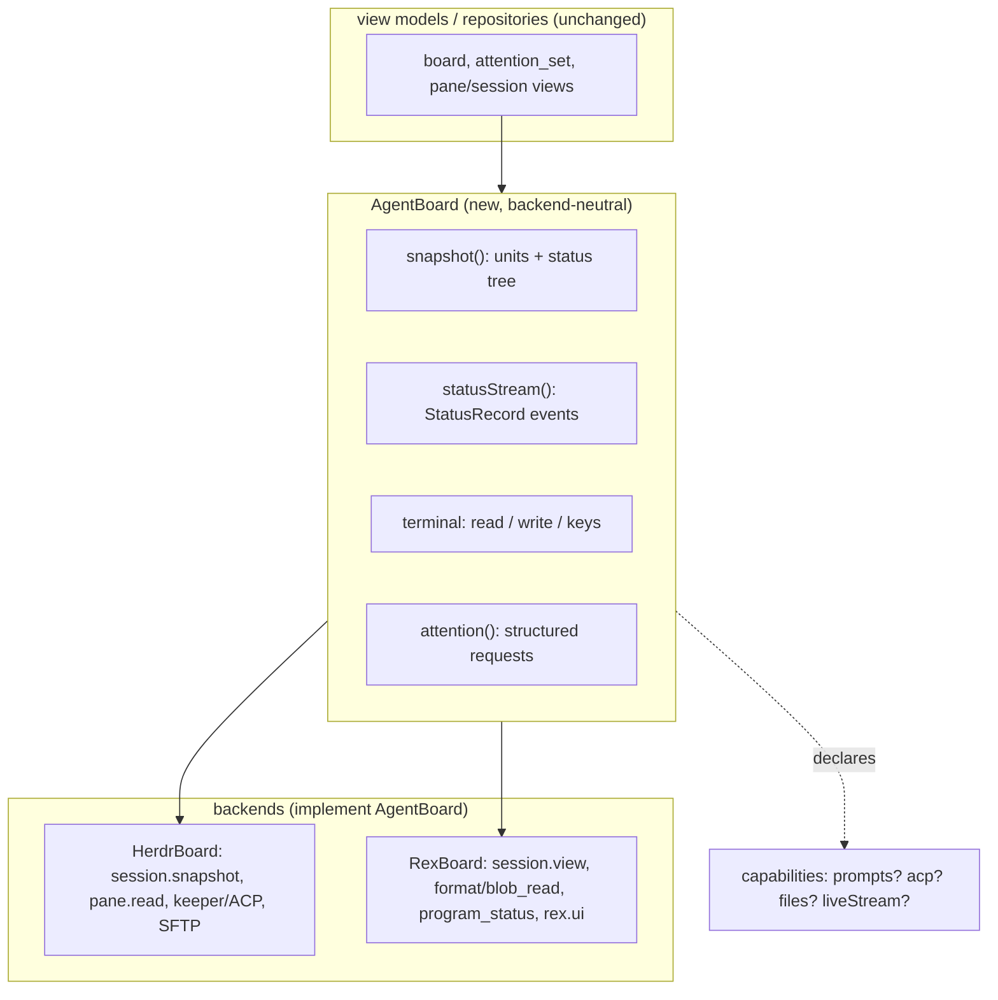

# Rex protocol: can it replace herdr as a herdr-mobile backend?

Research note, 23 Nov 2026. Rex is Superlogical's (Mitchell Hashimoto's)
terminal multiplexer, in public beta (`rex` 0.1.0-preview.21, api revision 18).
The question: can the phone app talk to a Rex server the way it talks to herdr
today, as an **alternative backend** for machines that run Rex?

Everything below about the wire format was **verified live** against a local
Rex server on this machine (a scratch `rex server run` on a throwaway socket;
the owner's real server was not touched). A working Python reference client
for the control plane lives in `/tmp/rexbin/rexws.py` (throwaway, not in git).

## TL;DR

**Yes, with a smaller surface than herdr, and one thing herdr doesn't give
you: a first-class "needs you" signal.** The control plane is a JSON-over-
WebSocket protocol that a Dart client can speak directly — no python3 mux
script, no socat fallback. The status model (OSC 7501) maps 1:1 onto the
board's `PaneStatus` (`blocked`/`working`/`done`/`idle`). The main gaps are:
**no SFTP** (files are block methods, not a subsystem) and the **live
terminal stream is a binary subprotocol** (`rex.data.terminal.v1`) whose
frame layout is not documented and was not fully reversed here.

ACP agent sessions are **not** a gap: they run on the keeper (python3 + the
agent binary, reached by SSH exec → unix socket), which is herdr-independent
— a Rex host that has python3 + the agent gets them for free. What a Rex
backend does not give: the full SFTP file browser, the live (non-polling)
terminal stream, and worktrees.

## The wire protocol (verified)

### Transport

- The server listens on Unix sockets by default; add a network listener with
  `--extra-listen http://HOST:PORT --allow-anonymous` (or Tailscale). All
  three API endpoints are on the same listener:
  - `GET /api/help` — the full self-describing API (methods, JSON Schemas,
    examples). This is the source of truth; do not hard-code method lists.
  - `/api/control` — WebSocket, subprotocol **`rex.control.v1`**.
  - `/api/data` — WebSocket, subprotocol **`rex.data.terminal.v1`** (binary).
- The control WS accepts `permessage-deflate` (the CLI negotiates it), but
  the server also accepts plain frames; responses were observed unmasked/
  uncompressed. A client MAY skip deflate.
- Auth today is by transport only: the SSH path (the CLI's `ssh://` host)
  means "whoever this SSH login is". A plain TCP listener with
  `--allow-anonymous` admits **every** caller with full access. There is no
  token auth on the control channel yet (the docs say a real auth system is
  planned). **Implication: a phone reaching Rex must go through something
  that identifies it — an SSH tunnel to the Unix socket, or Tailscale — not
  a bare TCP listener.**

### Control channel messages

All JSON text frames. Envelope is symmetric: `payload` carries both request
args and response result.

```
C->S  {"type":"hello","client":{"kind":"app","name":"herdr-mobile","version":"0.1"}}
S->C  {"type":"welcome","protocol":"rex.control.v1",
       "limits":{"max_message_bytes":1048576},
       "client":{"id":"client:<uuid>","reconnect_token":"..."},
       "api_server_revision":18}

C->S  {"type":"request","id":"<string>","method":"session.view","payload":{"session_id":"session:<uuid>"}}
S->C  {"type":"response","id":"<string>","seq":0,"payload":{...}}
S->C  {"type":"event","seq":N,"payload":{...}}      # interleaved, no id
```

Gotchas found by trial (these cost real debugging time):

- `id` must be a **string**.
- The args field is **`payload`**, not `params`. A request with `params` is
  accepted and the args are silently decoded as empty (`session_id is
  required` / a zero UUID). The `payload` name is consistent with responses.
- `session.create` takes `initial_windows: [{layout: {block: {flavor,
  options}}}]`, not `windows`. The terminal flavor is
  `com.superlogical.terminal.shell`; its `size` option is
  `{columns, rows}` (not `{cols, rows}`).
- `session.attach` returns the session `view`; `session.attach_all`
  (`event_scope: "session"|"all"`) starts server-wide events. Most
  `session.` methods require the connection to be attached first
  (`conflict` otherwise).
- Reconnect is built in: the welcome carries a `reconnect_token`, and the
  server "keeps the client for reconnect" when a control connection drops.

### The methods herdr-mobile would use (all verified)

| Job herdr does today | Rex equivalent | Verified |
| --- | --- | --- |
| list boards/workspaces | `session.list` | yes |
| read a pane's screen | `block.method` → `com.superlogical.terminal.format` (`{content}`) | yes |
| read pwd / title | `block.method` → `…terminal.pwd`, `…terminal.title` | yes |
| **read agent/program status** | `block.method` → `…terminal.program_status` (`{records:[{state,kind,app,msg,…}]}`) | yes |
| type text / paste | `block.method` → `…terminal.write` (`{data}`) or `block.event` (`paste`) | yes |
| press a key | `client.key` (`{key:{key:"enter",type:"press"}}`, W3C key codes) | yes |
| create a session/pane | `session.create` (+ `initial_windows`), `session.new_split` | yes |
| close a pane | `block.close` | (schema read) |
| event stream | `session.attach_all` + `{"type":"event"}` frames | yes |
| version | `server.version` | yes |

### Events

`session.attach_all` streams `{"type":"event","seq":N,"payload":{...}}`.
Session events are wrapped as `session_event → block_event`; terminal events
carry `creator_name: "com.superlogical.terminal"` and a `name`. The ones that
matter for the board:

- `terminal.program_status_changed` — **the "needs you" signal.** Payload
  `record` = `{state, kind, app, msg, …}`. Verified: a program that emits
  OSC 7501 `state=blocked:kind=permission` produces this event and a
  `program_status` record.
- `terminal.child_exited` — program ended.
- `terminal.pwd_changed`, `terminal.title_changed`, `terminal.bell`,
  `terminal.process_changed`.
- `session_created` / `session_destroyed`, `client_joined/left`.

Note: `program_status_changed` arrives on the **control** channel (via
`attach_all`), not the data channel. So the attention model needs only the
control connection — no live terminal stream.

### Live terminal stream (NOT fully reversed)

`data.connect {session_id, block_id, data_ref_id:"terminal",
subprotocol:"rex.data.terminal.v1"}` returns a one-time `ticket`. You open
`/api/data`, send the ticket in a **binary** HELLO, and then the stream is a
**binary frame protocol** (opcodes; e.g. `0x02` = a 2-byte header frame was
observed, and "data handshake message type %d is not binary" / "unknown data
handshake opcode 0x%02x" are in the binary). The exact frame layout, the
HELLO binary shape, and the scrollback/resize semantics are **not in the
public docs** and were not reversed here. This is the one protocol piece that
would need dedicated reverse-engineering before the phone could show a
*live* (not polled) Rex terminal.

This is a real gap versus herdr, where the phone reads `pane.read` deltas
over the mux. But it is also optional: `format` gives a full screen on
demand, so a **polling terminal** (re-read `format` on a timer / on
`program_status_changed` / on `bell`) is achievable with the control plane
alone.

### OSC 7501 (Program Status Protocol) — the part herdr lacks

Rex defines a generic terminal escape, `OSC 7501 ; key=value:key=value ST`,
where a running program reports `state` ∈ {idle, working, done, blocked,
error}, plus `kind` ∈ {permission, question, auth}, `app`, `msg`, `progress`,
and a hierarchical `id`. The terminal stores one record per id; `blocked`
survives process exit. This is exactly the board's status vocabulary, and it
is **emitted by the program itself** (agents that adopt it), not inferred by
parsing screen text. herdr-mobile currently derives status heuristically
from pane content and agent logs; a Rex host would give it for free, and more
accurately (it's the program's own word, with `kind` distinguishing
"approve this command" from "answer this question" from "log in").

Adoption is the open question: does the agent you run under Rex (Claude
Code, Codex, omp, pi) emit OSC 7501? Rex ships an "agent skill" that teaches
agents to use the API; whether the agents themselves emit 7501 is
**unverified** and is the single most important thing to check before
betting the attention model on it.

## How it maps onto herdr-mobile's architecture

The app is layered `ui/ → view models → data/repositories → data/services`,
and the seam is the `HerdrTransport` interface
(`app/lib/data/services/herdr_transport.dart:82`):

```dart
abstract interface class HerdrTransport {
  Future<Map<String,dynamic>> request(String method, [Map<String,dynamic> params]);
  Stream<Map<String,dynamic>> events(List<Map<String,dynamic>> subscriptions);
  void setBackground(bool); void reset();
  Future<ExecChannel> openExec(String command, {bool zipped});
  bool get supportsFiles;
  Future<RemoteStat> statFile(String path);  // … SFTP surface
}
```

`SshTransport` implements it (SSH + mux). A `RexTransport` would implement
the same interface over a WebSocket:

- `request(method, params)` → one `{"type":"request","payload":params}`
  frame, match the `response` by `id`. This is the cleanest possible
  fit: herdr's `method/params → result` shape is almost identical to Rex's
  `method/payload → payload`, so `HerdrApi`
  (`app/lib/data/services/herdr_api.dart`) needs only a thin method-name
  translation table, not a rewrite.
- `events(subs)` → `session.attach_all` + forward `{"type":"event"}` frames,
  translating Rex event names to the herdr names the repositories already
  switch on (`pane.updated`, `pane.agent_status_changed`, …).
- `openExec` / `supportsFiles` → **not available.** Rex has no SFTP and no
  generic exec channel. Files are block methods (`list_dir`, `blob_read`)
  with a narrow, security-limited path scope, not a filesystem browser. A
  Rex machine would report `supportsFiles == false` and the Files feature
  would be disabled for it.

The connection model stays the same: one `MachineConnection` per machine,
one transport in a worker isolate
(`app/lib/data/services/isolate_transport.dart`,
`transport_factory.dart`). The difference is the wire: instead of
"SSH → python3 mux script → herdr socket", it is "WebSocket → Rex server".
That **removes** the whole fallback chain (`remote-api-bridge` → `socat` →
python relay, `bridge_command.dart`) and the python3 dependency for the
board/terminal path. For a Rex host the phone needs only a reachable Rex
listener (over an SSH tunnel or Tailscale) — no python3 on the host.

### Where the seam is and how big it is

- **Small, clean seam.** Adding `RexTransport implements HerdrTransport` +
  a method-translation table + an event-name translator is a bounded change
  behind an existing interface. The board, attention set, and terminal read
  would work with no repository changes.
- **Machine profile** (`MachineProfile`) would gain a `backend: herdr|rex`
  (or "auto: probe `/api/help`") so the factory picks the transport.
- **Gaps stay gaps.** The full file browser (SFTP) and the live terminal
  stream have no Rex equivalent today; they would be feature-flagged off for
  Rex machines, not silently faked. ACP agent sessions are *not* a gap —
  they run on the keeper, which is herdr-independent (see below).

## Custom features worth supporting (deep dive, verified live)

The herdr shim (board + terminal read + input) is the boring part. The
reason to take on Rex at all is the set of things it does **structurally**
that herdr can only do by parsing screen text. Each of these was driven
live against the scratch server, not read from docs.

### 1. Server-pushed prompts to the phone (`rex.ui` + `client_prompt_requested`)

This is the big one. A Rex server can **ask the person a structured
question on every connected device at once**, and wait for the answer.
Verified round-trip:

```
C->S  client.action  {action:"ask_branch"}            # action runs rex.ui.input
S->C  event client_prompt_requested
        {call_id:"1", action:"ask_branch",
         prompt:{kind:"input", title:"New branch name",
                 placeholder:"feature/…", confirm:"Use it"},
         timeout_ms:25000}
C->S  client.reply   {call_id:"1", result:{text:"feature/rex-phone"}}
S->C  response       {result:{answered:true, branch:"feature/rex-phone"}}
```

`kind` is `input` (free text) or `pick` (a list of `{id,title,subtitle,
icon,detail,selected}` items, with `multiple` and `allow_other` for typed
answers). The phone answers with `result:{text}` / `{ids:[…]}` /
`{cancelled:true}`.

**Multi-device is first-class and verified:** two connected clients both
received the same `client_prompt_requested`; the one that answered closed
the prompt on the other, which got `client_prompt_ended {reason:"answered"}`.
First answer wins, cancel propagates, `timeout_ms` is enforced by the server.

Why this matters for herdr-mobile: today the app answers a permission by
**parsing the pane** to find the question and the options, then typing a
choice back. With Rex the *structure* of the question (it's a pick between
these items, it's a text field, it expires in Ns) arrives as data. The
"answer from the notification" flow becomes exact, and the risky-answer
guards (hold-to-confirm for `kind=permission`) can key off real data instead
of heuristics. This is the closest Rex gets to the app's core promise, and
it's something herdr does not offer at all.

The action that asks can live in the server's `init.lua`
(`rex.action{…rex.ui.input…}`) — verified. Client-side scripts
(`client.set_script`) can *receive* prompts, but on preview.21 a
client-script action can't yet be *invoked* server-side ("runs from a later
version"). So: the prompts are real and usable; the *trigger* is a server
config action or a newer-Rex client action.

### 2. Subagents, as a status tree (OSC 7501 `id` paths)

Verified: one process can hold many records at once, keyed by hierarchical
`id`, each with its own state/kind/msg. Emitted four and read all four back:

```
id=build          working              "orchestrating"
id=build/deploy   working              "pushing image"
id=build/test     blocked/permission   "run rm -rf dist?"
id=build/test2    done                 "tests passed"
```

`effective_app` inherits the parent's `app` (the icon cascades down the
tree). So the board can render a **parent agent with live subagent rows**,
each independently `blocked`/`working`/`done` — "build → test is blocked on
a permission" — with no log parsing. Two caveats observed: a record's
`working`/`blocked` state is dropped when a new shell prompt begins (so the
emitting process must stay in the foreground, as a real agent does), and
`done`/`error` survive. This is strictly richer than herdr's flat per-pane
status.

### 3. Files without SFTP — browsing on the control plane

Verified: `list_dir` (control plane) lists a directory; returns
`{path, home, status, entries:[{name,…}]}` with `prefix`/`limit`
pagination and a real `status` (`ok`/`missing`/`not_dir`/`denied`).
`download_begin {ref, path}` returns `{ticket, size, version, modified_at}`
— the metadata is control-plane, and the **bytes stream over `/api/data`**
(the binary plane), with `if_none_match` versioning so an unchanged file
costs no transfer. So:
- browse + metadata + "what changed" → control plane only (no SFTP).
- file *content* → data plane (same binary channel as the terminal stream).

This is not a replacement for the full SFTP browser (no arbitrary tree walk,
narrow path scope, content needs the data plane), but it is enough for a
"peek at this file / what changed" on the session screen, and it means a
Rex host needs no `sftp` subsystem.

### 4. Control-plane content reads (no data plane for a phone viewer)

Verified: `format {max_bytes}` returns `{content, id, total}`; when the
screen exceeds `max_bytes` you page the rest with `blob_read {id, offset,
max_bytes}` → `{data, total, eof}`. So a phone can read a large screen /
file in chunks **entirely on the control channel** — no need to reverse the
`rex.data.terminal.v1` binary stream to show a (polling) terminal or file
viewer. This substantially de-risks the "we don't have to read from files /
we don't have to crack the data plane" question: the control plane alone
covers board, attention, terminal read, file peek, and prompts.

### 5. Real process info (`process`), not title parsing

Verified: `block.method → process` returns `{foreground:{pid,user,name,
path,cwd,…}, child:{…}, last_exit}` — the actual foreground process, not a
guessed title. The app's "what agent is this pane running" can be exact.

### 6. The phone as an action target (`client.perform`)

The inverse of (1): the server can ask *a specific connected client* to
perform one of its own actions and wait for the result
(`client.perform` → `client_perform_requested` event → `client.reply`).
This is how Rex composes across devices and is the hook for a future
"the server asks the phone to do X" — e.g. run a camera scan, show a
local-only sheet, fetch a phone credential — without the phone polling.
(Schema verified; a full perform round-trip was not driven this pass.)

## What this changes about the recommendation

The earlier note framed Rex as "a second backend with a smaller surface."
The deep dive flips the value proposition: **the board is parity, but the
attention/answer loop is strictly better under Rex** — structured,
multi-device, server-pushed prompts + a subagent status tree, on a control
plane that needs no data-plane reverse-engineering for a polling UI. The
gaps (live stream, full file browser) are real but none of them block the
phone's core "does anything need me, and let me answer safely" job. (ACP
agent sessions are not a gap — they run on the keeper, herdr-independent.)

The one assumption that still gates everything: **does the agent you run
under Rex emit OSC 7501 and/or trigger a `rex.ui` prompt?** The prompt path
depends on a server-config action (or a Rex agent skill) calling `rex.ui`;
the status path depends on the agent emitting 7501. Both are *capable* per
the protocol; neither is confirmed for a specific agent (omp / Claude Code /
Codex) on this pass. That is the first thing to verify before shipping, and
it's a small, cheap check (run one agent, watch `program_status` and the
event stream).

## Effort and risk

| Work | Effort | Risk |
| --- | --- | --- |
| `RexTransport` (control plane): hello, request, events, `format`/`write`/`client.key`/`program_status` | Medium | Low — protocol is simple, verified, self-describing via `/api/help` |
| Method + event name translation in `HerdrApi`/repositories | Small | Low |
| `MachineProfile.backend` + factory selection + `/api/help` probe | Small | Low |
| Status mapping OSC 7501 → `PaneStatus` (already 1:1) | Small | **Medium** — depends on agents actually emitting 7501 (unverified) |
| Polling terminal (re-read `format`) | Small | Low |
| Live terminal stream (`rex.data.terminal.v1` binary) | **Large** | High — binary subprotocol undocumented; needs dedicated RE |
| Agent sessions / ACP under Rex | **None** | Low — the keeper is herdr-independent; a Rex host with python3 + the agent gets the same phone attach |
| File browser under Rex | Medium | Medium — block-method files, narrow scope, not a real FS API |
| Auth / reaching Rex securely from a phone | Medium | **High** — no token auth yet; must tunnel via SSH/Tailscale; a bare `--allow-anonymous` TCP listener is full-access to anyone |

## Recommendation

Treat Rex as a **second backend behind the existing `HerdrTransport`
seam**, not a replacement. The control-plane work is modest and de-risks the
board + attention + terminal-read for Rex hosts, and it **removes** the
python3/mux dependency for those hosts. Sequence it:

1. **Verify the one assumption that matters:** run one real agent (omp or
   Claude Code) in a Rex terminal and confirm it emits OSC 7501
   `blocked`/`working`/`done` (or at least that `program_status` reflects
   reality). If not, the "needs you" model falls back to the same heuristics
   herdr uses and the main advantage shrinks.
2. If (1) is good: implement `RexTransport` for the board + attention +
   `format`-based terminal read + `write`/`client.key` input. Ship it
   feature-flagged per machine.
3. Defer the live `rex.data.terminal.v1` stream and agent sessions until
   they're needed; the control plane is enough for a usable phone client.

Do **not** build on a bare `--allow-anonymous` TCP listener. The phone must
reach Rex over an SSH tunnel to the Unix socket (reusing the existing
`dartssh2` transport + a local forward) or Tailscale, matching the app's
existing "no public port, no account" security model.

## What was not done / unverified

- The `rex.data.terminal.v1` binary frame layout (live stream) — not reversed.
- Whether real coding agents emit OSC 7501 under Rex — not tested.
- ACP agent sessions on a Rex host: the keeper path is herdr-independent by
  code (no herdr call on `start`/`attach`), but an ACP session was not driven
  on a machine without herdr.
- Tailscale and SSH-tunnel access paths were read from the docs, not driven
  from the phone.
- API revision is 18 on preview.21; the protocol has explicit
  versioning/translation (`api_revision`, "translating %s request to API
  revision %d"), so expect the shape to be stable across patch releases but
  re-check `/api/help` per server.

## Does herdr support the "new" ones? (checked 23 Nov 2026)

herdr **0.9.5 is the current stable** (`herdr update` → "already up to date"),
and the bundled `docs/herdr-api.schema.json` is **byte-identical** to a fresh
`herdr api schema` (protocol 22). No drift, no newer methods to adopt.

Against the Rex features above, herdr's current surface (110 methods) has:

| Capability | herdr 0.9.5 | Rex |
| --- | --- | --- |
| Per-unit status `idle/working/blocked/done` | **yes** — `AgentStatus`, `pane.report_agent {state,message,agent,seq}` | **yes** — OSC 7501, `program_status` |
| **Subagent tree** (hierarchical ids) | **no** — flat per-pane; one `state` per pane | **yes** — `id` paths, verified |
| **Structured prompt to the phone** (pick/text, multi-device) | **no** — `notification.show` is title/body only; answers are typed into the pane after parsing it | **yes** — `rex.ui` + `client_prompt_requested`, verified |
| Foreground process (pid/name/cwd) | **yes** — `pane.process_info` | **yes** — `process` |
| Screen read | **yes** — `pane.read {source,lines,format}` | **yes** — `format` + `blob_read` chunks |
| Key/text input | **yes** — `pane.send_*` | **yes** — `write` / `client.key` |
| Agent sessions (ACP, survive phone drop) | **yes** — keeper (python3, SSH exec → unix socket) + `agent.*` | **yes, same keeper** — see below |
| File browser | **yes** — SFTP, full FS | **partial** — `list_dir` + data-plane download |
| Live terminal stream | **yes** — `pane.read` deltas over the mux | **binary** `rex.data.terminal.v1` (unreversed) |
| Worktrees | **yes** — `worktree.*` | no |

### ACP is not a herdr feature — it is the keeper

This changes the "Rex lacks ACP" claim. The phone's agent sessions do **not**
run through herdr. They run through the **keeper**: the app SSH-execs
`python3 ~/.herdr-mobile/keeper-<ver>.py attach <id>` and bridges the channel
to the keeper's unix socket — ACP JSON-RPC both ways
(`keeper_command.dart` `keeperAttachCommand`, "Bridges the channel's
stdin/stdout to the keeper's socket: lines of ACP JSON-RPC"). The keeper
owns the agent process; it outlives the phone's link and needs only
**python3 + the agent binary** on the host.

The herdr coupling inside the keeper is the *optional* "open a tab in a
herdr pane so the session is visible on a desktop" path
(`keeper_script.dart` `open_pane`, gated by `HERDR_MOBILE_NO_PANE` /
`~/.herdr-mobile/no-panes`, and a no-op when `not herdr`). The core
`start`/`attach` path is herdr-free — which is why herdr-tui's contract test
runs "hermetic: its own home, **no herdr**".

So a Rex host that also runs python3 + the agent gets **ACP agent sessions
for free, through the same keeper** — the phone attaches exactly as it does
to a herdr machine. The only thing a Rex host lacks is the *desktop
visibility* tab (a herdr pane showing the session), which is cosmetic for the
phone. `herdr-tui` (the Rust desktop viewer) is the same keeper fronted by a
TUI, so it runs on a Rex machine too.

So: **ACP agent sessions are backend-neutral (the keeper) and work on both.**
herdr's exclusive edges are the **full file browser (SFTP), the live
`pane.read` stream, and worktrees**. Rex's exclusive edges are the two
structural ones — **the subagent tree and the server-pushed structured
prompt** — plus a control-plane `blob_read` path that avoids the data plane.
Neither is a superset; the union is covered by a shared core + capabilities.

## Interface design: one supervisor API, two backends

The seam to build at is **`HerdrApi`** (the typed facade the repositories
call, `app/lib/data/services/herdr_api.dart`), not `HerdrTransport` (the raw
wire). `HerdrTransport` stays per-wire (SSH+mux for herdr, WebSocket for Rex).
`HerdrApi` today is herdr-shaped (method names, `Snapshot`, `pane_id`). The
move is to lift the *supervisor* surface it already expresses into a
backend-neutral API and let each backend implement it.

### Why a narrow core, not "full protocol"

"Support the full protocol" of *both* means a god-interface: herdr's
worktrees + ACP + SFTP + `pane.read` deltas on one side, Rex's prompts +
status tree + `blob_read` on the other, none shared. The least-common
denominator throws away ACP; the union is unmaintainable. The right shape is a
**core both implement fully, plus declared capabilities** the UI feature-
detects. The board and the "does anything need me, answer safely" loop are the
core — that is the app's product (`AGENTS.md`). Everything else is a
capability.



### The core (both backends, fully)

```dart
/// One supervised unit: a herdr pane, a herdr agent session, a Rex block.
class BoardUnit {
  final String id;            // stable per machine
  final String label;
  final StatusRecord root;    // its current status (the board row)
  final List<StatusRecord> children;  // subagents; empty for herdr
  final ProcessInfo? process; // foreground pid/name/cwd
}

/// A status leaf. Herdr: one per pane. Rex: one per OSC 7501 id.
class StatusRecord {
  final String id;            // "" = root; "build/test" = subagent
  final AgentStatus state;    // blocked/working/done/idle  (already shared)
  final AttentionKind? kind;  // permission/question/auth    (Rex; herdr infers)
  final String? app;          // "claude", "codex", …
  final String? message;      // "run rm -rf dist?"
  final DateTime? since;
}

abstract interface class AgentBoard {
  Future<List<BoardUnit>> snapshot();
  Stream<StatusRecord> statusStream();        // drives the board live
  Future<String> readTerminal(String unitId, {int? lines, bool ansi});
  Future<void> writeTerminal(String unitId, String text, {List<String> keys});
  Stream<AttentionRequest> attention();       // the "needs you" queue
  BackendCapabilities get capabilities;
}
```

`AgentStatus` is **already** the shared enum (`app/lib/data/models/
herdr_models.dart:57`) — no change. `StatusRecord.id` is what turns herdr's
flat rows into the *same* rendering Rex's tree uses: herdr fills `children`
empty, Rex fills it from the `id` paths. The board code is identical.

### The part that changes the answer flow: `AttentionRequest`

Today a blocked pane becomes an `AttentionItem` and the answer is typed into
the pane after the app *parses the screen* for the question. Model the
request itself as data, with the backend filling what it knows:

```dart
class AttentionRequest {
  final String unitId;
  final AttentionKind kind;      // permission / question / auth
  final String? message;         // the question text
  final List<AnswerOption>? options;  // structured choices
  final AnswerForm form;         // text / pick / raw-typing
  final DateTime? expiresAt;
  Future<void> answer(Answer a);  // backend routes it
}
```

- **Rex backend:** `form` is `pick`/`text`, `options` is populated, `answer()`
  sends `client.reply`. Exact, structured, multi-device.
- **herdr backend:** `form` is `raw-typing`, `options` is the app's best parse
  of the pane (today's behavior), `answer()` calls `pane.send_input`. Same
  sheet, same guards (hold-to-confirm keys off `kind == permission`), just a
  less-structured `options`.

This is the design payoff: **one attention sheet, one set of safety guards,
two backends** — and the Rex host gets the exact version for free.

### Capabilities (declared, not faked)

```dart
class BackendCapabilities {
  final bool structuredPrompts;  // Rex yes, herdr no
  final bool subagentTree;        // Rex yes, herdr no
  final bool fileBrowser;         // herdr yes (SFTP), Rex partial
  final bool liveTerminalStream;  // herdr yes, Rex no (until reversed)
  final bool worktrees;           // herdr yes, Rex no
  // NOT a backend capability: ACP agent sessions run on the keeper (python3
  // + agent binary on the host), reached by SSH exec -> unix socket. Same on
  // both backends; it is a HOST capability, declared by the keeper `probe`.
}
```

The UI shows/hides per machine. A Rex machine: board + attention + terminal
read/write + **structured prompts + subagents** + **ACP agent sessions
(keeper)**, with the full Files browser / worktree rows dimmed and reasoned
(the "never a dead end" rule). A herdr machine: today's full app. The ACP
agent-session UI is shared code on both — only the board/status/attention
source differs.

### Sizing

- `AgentBoard` + `BoardUnit`/`StatusRecord`/`AttentionRequest`/
  `BackendCapabilities`: a new small file, no repository churn.
- `HerdrBoard`: re-expresses what `HerdrApi` already does (snapshot →
  `BoardUnit`, `pane.read` → `readTerminal`, `RemoteFiles` under
  `fileBrowser`). Mostly a rename + adapter, low risk. ACP agent sessions
  are not on this board at all — they stay on the keeper path, shared.
- `RexBoard`: the new work — `session.view` → `BoardUnit`, `program_status` →
  `StatusRecord` tree, `format`/`blob_read` → `readTerminal`, `write`/
  `client.key` → `writeTerminal`, `client_prompt_requested` →
  `AttentionRequest`. Bounded, behind the interface.
- The board, `attention_set`, and the attention sheet keep working on the
  core; only capability-gated features branch.

This is the answer to "support full protocols": **not both in full, but the
supervisor core in full on both, and each backend's extras as declared
capabilities.** The two structurally-better Rex features (subagent tree,
structured prompts) slot into the core; ACP agent sessions are shared on the
keeper (a host capability, not a backend one); herdr's remaining exclusive
edges (SFTP file browser, live `pane.read`, worktrees) stay capabilities herdr
declares and Rex doesn't.
